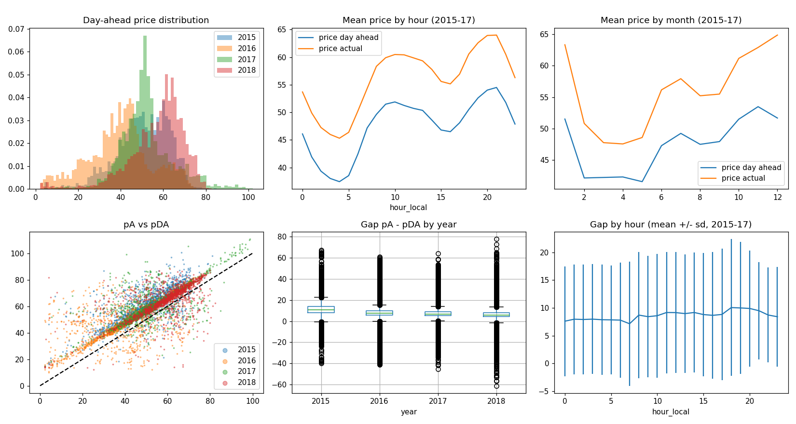
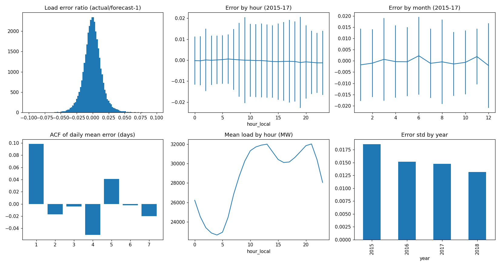
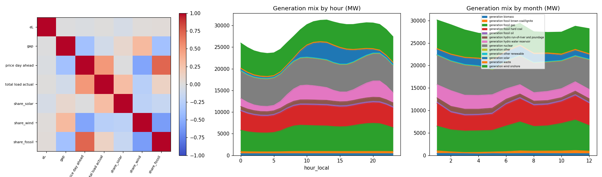
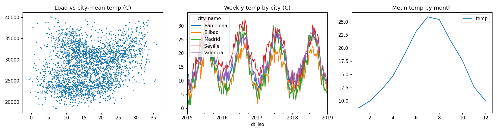
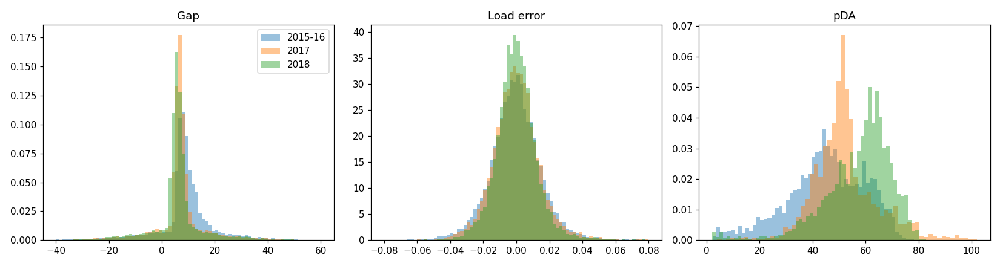

# EDA REPORT

Decisions are based on **2015-2017 only**. 2018 (the test year) is described in the stability section for context and has influenced **no** modeling choice.

## 1. Structure and quality
- Energy file: shape (35064, 29), weather file: shape (178396, 17); both match the expected sizes. Energy memory ~8.1 MB.
- Time index (UTC) is continuous: 35064 rows, 35064 unique, no gaps, no duplicates. Local-time (Europe/Madrid) days with 23 hours: 4; with 25 hours: 4 (DST). **Decision:** day arrays are built by local hour; the repeated hour on 25-hour days keeps its first value and the missing hour on 23-hour days is interpolated, so every day has 24 hours.
- Duplicate full rows in the energy file: 0. Weather city-hour duplicates: 3076 (stray whitespace in city names was stripped; city counts raw: {'Madrid': 36267, 'Bilbao': 35951, 'Seville': 35557, 'Barcelona': 35476, 'Valencia': 35145}). **Decision:** keep the first row per city-hour; after cleaning every city has 35,064 hours. Hourly city-average weather (temp, humidity, wind, clouds, pressure) is used.
- Temperatures converted from Kelvin to Celsius (subtract 273.15).
- Entirely empty columns: ['generation hydro pumped storage aggregated', 'forecast wind offshore eday ahead']. Constant columns (0 or one value): ['generation fossil coal-derived gas', 'generation fossil oil shale', 'generation fossil peat', 'generation geothermal', 'generation marine', 'generation wind offshore']. **Decision:** drop all of them (`['generation fossil coal-derived gas', 'generation fossil oil shale', 'generation fossil peat', 'generation geothermal', 'generation hydro pumped storage aggregated', 'generation marine', 'generation wind offshore', 'forecast wind offshore eday ahead']`).
- Missing values: {'generation biomass': 19, 'generation fossil brown coal/lignite': 18, 'generation fossil coal-derived gas': 18, 'generation fossil gas': 18, 'generation fossil hard coal': 18, 'generation fossil oil': 19, 'generation fossil oil shale': 18, 'generation fossil peat': 18, 'generation geothermal': 18, 'generation hydro pumped storage aggregated': 35064, 'generation hydro pumped storage consumption': 19, 'generation hydro run-of-river and poundage': 19, 'generation hydro water reservoir': 18, 'generation marine': 19, 'generation nuclear': 17, 'generation other': 18, 'generation other renewable': 18, 'generation solar': 18, 'generation waste': 19, 'generation wind offshore': 18, 'generation wind onshore': 18, 'forecast wind offshore eday ahead': 35064, 'total load actual': 36} - at most a few hours per column. **Decision:** time-interpolate gaps up to 6 hours.
- Units: `price day ahead` mean 49.9 and range 2.1-102.0, consistent with EUR/MWh.

## 2. Prices

| year | price day ahead_mean | price day ahead_std | price day ahead_min | price day ahead_max | price actual_mean | price actual_std | price actual_min | price actual_max | gap_mean | gap_std | gap_min | gap_max |
|---|---|---|---|---|---|---|---|---|---|---|---|---|
| 2015 | 50.325 | 12.370 | 4.000 | 85.050 | 61.361 | 12.333 | 13.480 | 102.620 | 11.036 | 8.990 | -39.700 | 67.150 |
| 2016 | 39.667 | 14.895 | 2.300 | 75.500 | 47.437 | 14.174 | 9.330 | 86.400 | 7.770 | 12.351 | -41.200 | 60.740 |
| 2017 | 52.239 | 12.281 | 2.300 | 101.990 | 59.327 | 12.261 | 11.980 | 116.800 | 7.088 | 9.745 | -45.490 | 64.230 |
| 2018 | 57.294 | 12.801 | 2.060 | 84.130 | 63.439 | 12.217 | 10.660 | 91.930 | 6.145 | 10.182 | -61.040 | 77.580 |

- Negative or zero day-ahead / actual price counts by year [pDA<=0, pA<=0]: {2015: [0, 0], 2016: [0, 0], 2017: [0, 0], 2018: [0, 0]}. Prices are strictly positive in the actual series; spikes are moderate (max pDA 102). **Decision:** no outlier removal.
- Strong hour-of-day profile (night low, morning/evening high) and a seasonal level shift; 2016 was a low-price year.
- **`price actual` vs `price day ahead`:** the gap `g = pA - pDA` is positive in this share of hours by year: 2015: 92.6%, 2016: 86.3%, 2017: 88.4%, 2018: 87.8%. Mean gap by year: 2015: 11.04, 2016: 7.77, 2017: 7.09, 2018: 6.15. Median ratio pA/pDA: 2015: 1.21, 2016: 1.18, 2017: 1.13, 2018: 1.10. The correlation of the gap with the day-ahead price (2015-17) is -0.37.
- **Interpretation:** the gap is positive in 86-93% of hours and is largest when pDA is low, so `price actual` behaves like a *realized price including additional components* (e.g. adjustment-service/capacity charges), not an independent balancing settlement. The gap **shrinks over time** (mean falls every year), so the test year has a smaller gap than the training years.
- **Decision:** `price actual` is treated as the buyer's settlement price `p_A` for any deviation from the day-ahead purchase (as the task defines). Consequence: shortfalls cost only a modest premium over pDA while surplus (at rho=0) is wasted at the full pDA, so the optimal purchase is *below* the load forecast. If the gap reverses in some hours, `Cu <= 0` and the rule buys zero in those hours (handled by the regime logic). Because the gap shrinks, the optimal bias toward under-buying shrinks in 2018; this is a real distribution shift to be reported.

## 3. Load

- Error ratio `e_L = actual/forecast - 1` by year (bias, std, MAE):

| year | bias | std | mae |
|---|---|---|---|
| 2015 | -0.001 | 0.019 | 0.013 |
| 2016 | -0.000 | 0.015 | 0.011 |
| 2017 | 0.000 | 0.015 | 0.011 |
| 2018 | -0.000 | 0.013 | 0.009 |

- Bias is ~0 overall (not significant relative to spread); std ~1.3-1.9%. Error by hour has std ranging 0.0115-0.0217; mean bias by hour ranges -0.0013 to 0.0006.
- Autocorrelation of the daily mean error (lags 1-7 days): [0.1, -0.02, -0.0, -0.05, 0.04, -0.0, -0.02]; hourly error ACF at lags 1h/24h/48h/168h: [0.84, 0.06, -0.01, -0.01]. Errors are strongly persistent within a day (hourly lag-1 ACF) but essentially uncorrelated across days, so lagged errors (which must be >= 2 days old) carry little information; this is expected to limit the forecasting agent's gains over the TSO forecast.
- Largest mean-absolute-error days (2015-17): 2015-05-01 (6.6%), 2015-06-01 (6.3%), 2017-01-05 (5.5%), 2017-12-25 (4.9%), 2015-03-01 (4.3%), 2015-03-20 (4.2%).
- Because the load forecast error is only ~1.5%, the value of improving load quantiles is small compared with the price-gap effect.

## 4. Coupling

- Correlation (2015-17): load error vs price gap -0.00; load error vs day-ahead price -0.03. The correlation matrix includes price vs load, and vs solar/wind/fossil shares (merit-order effect: higher wind share goes with lower price; see figure).
- Generation mix changes with hour (solar peak midday) and season (more hydro/wind in winter-spring).

## 5. Weather

- City-mean temperature vs load correlation (2015-17): lag 0h 0.22, 24h 0.22, 48h 0.22; correlation is weak/non-monotone (heating and cooling both raise load). **Decision:** only lagged temperature (day D-2 mean and 7-day mean) is used; weather of the delivery hours is never used (observation, not a forecast).

## 6. Stability across years

| period | pDA | pDA_sd | gap | gap_sd | eL_sd | load |
|---|---|---|---|---|---|---|
| 2015-16 | 44.989 | 14.693 | 9.401 | 10.927 | 0.017 | 28435.299 |
| 2017 | 52.239 | 12.281 | 7.088 | 9.745 | 0.015 | 28858.548 |
| 2018 | 57.294 | 12.801 | 6.145 | 10.182 | 0.013 | 29064.700 |

- The price level and the price gap shift between periods (the gap mean falls from 2015-16 to 2017 to 2018); the load-error spread is stable-to-falling (1.9% in 2015, 1.3% in 2018). **Implication:** the validation year 2017 is a reasonable but imperfect proxy for 2018; gains that rely on a large price gap will be smaller in the test year. 2018 is shown for description only.

## 7. Leakage audit (decision cutoff = day D-1 around noon; `cutoff_days = 2`)
| column | availability | status |
|---|---|---|
| price day ahead (day D) | published ~12:00 D-1 | ALLOWED |
| forecast solar / wind onshore day ahead (D) | published before cutoff | ALLOWED |
| forecast wind offshore eday ahead | empty in file | DROPPED (all NaN) |
| total load forecast (D) | published before cutoff | ALLOWED |
| calendar features of D | known | ALLOWED |
| price actual, total load actual, generation * of day <= D-2 | settled before cutoff | ALLOWED (lagged) |
| price actual, total load actual, generation * of D-1 and D | after cutoff | FORBIDDEN |
| weather (temp, wind, ...) of D | observation, not forecast | FORBIDDEN |
| weather of days <= D-2 (city mean) | observed earlier | ALLOWED (lagged) |
| weather_main / description / icon | labels | NOT USED |

## 8. Decisions recorded
- **Columns kept:** time, 14 non-constant generation columns, 2 day-ahead generation forecasts (solar, wind onshore), load forecast and actual, both prices, city-mean weather. **Dropped:** ['generation fossil coal-derived gas', 'generation fossil oil shale', 'generation fossil peat', 'generation geothermal', 'generation hydro pumped storage aggregated', 'generation marine', 'generation wind offshore', 'forecast wind offshore eday ahead'].
- **Duplicates/outliers:** weather duplicates keep-first; no outlier removal; short gaps interpolated.
- **Price definitions:** `p_DA = price day ahead` (purchase), `p_A = price actual` (settlement of deviations).
- **Customer size:** `L_h = s * total load actual`, `s = 3.484529e-04` so the mean load is 10 MW; cap = 1.5 x forecast.
- **Regime (2015-17, hourly):** with rho=0: share of hours with Cu<=0: 10.9%, Co<=0: 0.0%; critical fractile tau mean 0.18 (p10 0.01, p90 0.35). rho=0.5: tau mean 0.34; rho=0.8: tau mean 0.67, Cu<=0 share 10.9%. So the regime is the **interior newsvendor regime** in ~89% of hours with tau well below 0.5 at rho=0 (buy below forecast), and `Cu <= 0` (buy zero) in the ~11% of hours where the gap is non-positive; tau rises toward and above 0.5 as resale improves.
- **Defaults:** rho = 0 (also 0.5 and 0.8 as sensitivities), pi = 0, alpha = 0.95, cutoff_days = 2.
- **Reference costs (mean daily EUR, 2015-17, 10 MW customer):** {"TSO forecast": 11688, "nothing": 13633, "cap": 17419, "oracle": 11604}; `C_ref` (train 2015-16, buy TSO forecast) = 11,046 EUR/day.
- **Feature whitelist:** see `features.py` (hour/dow/month cyclic, offday flag, pDA, Lhat, solar and wind day-ahead forecasts, load error and price gap lags >= cutoff, 7-day lag statistics, lagged temperature).
- **Burn-in:** the first 10 days of 2015 have incomplete lag features and are excluded from training episodes.
- **Periods excluded:** none.
